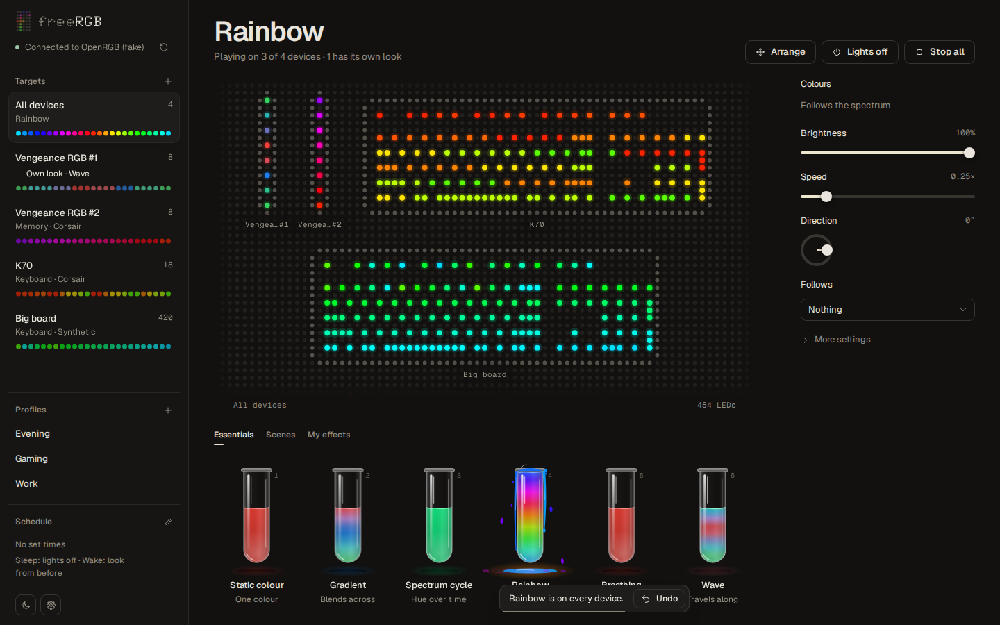

# freeRGB

A calm, lightweight desktop app for RGB lighting on Windows 11 and Linux. It is a front-end for
[OpenRGB](https://openrgb.org), so it lights the same hardware: fans, RAM, motherboards,
keyboards and more from many vendors, in one place. Not affiliated with or endorsed by the
OpenRGB project.

**Status: beta.** Download it from the [releases page](https://github.com/pwalda/freergb/releases);
[docs/INSTALL.md](docs/INSTALL.md) explains the steps. Bugs and ideas go to the
[issues](https://github.com/pwalda/freergb/issues).



- One look for every device in a click, or a different look per device or per group of devices.
- Twelve software effects with a live preview, built-in device modes per zone, and painting LEDs by hand.
- Profiles that switch from the window or the tray, a schedule for times of day and the PC's sleep and wake, and Lights off. The lights go off when the PC shuts down.
- Looks that follow the CPU or GPU temperature or load, what the PC plays, or the screen.
- Lives in the tray and costs almost nothing while it sits there. Updates install from within the app.

## Install

See [docs/INSTALL.md](docs/INSTALL.md) for Windows and Linux, including device access on Linux.

## Privacy

freeRGB has no accounts, ads or telemetry. It talks to the OpenRGB server on this PC and, once
a day, fetches the update feed from `raw.githubusercontent.com`. On Windows the installer
downloads PawnIO from its official release only when you ask for it.

## For developers

`PARITY.md` lists what the OpenRGB SDK exposes and what freeRGB does with it;
`docs/UPSTREAM-FACTS.md` records verified upstream facts.

### Layout

| Path | What |
|---|---|
| `crates/freergb-protocol` | OpenRGB SDK wire codec, protocol versions 0-6. Pure bytes, no I/O. |
| `crates/freergb-mock` | Scriptable mock SDK server (hotplug, crash/restart, slow, malformed, version mismatch). |
| `crates/freergb-sdk` | Async protocol-6 client with a device store, behind the `RgbBackend` trait. Settings writes are schema-validated; `DeviceKey` identifies devices across server restarts. |
| `crates/freergb-supervisor` | Detect-first server supervisor: adopt a running OpenRGB, or launch and babysit a bundled one (backoff, crash-loop limit, plain-language `Failed` states). |
| `crates/freergb-effects` | Effects: declarative JSON effect format, pure renderer, and a frame-loop engine (fps cap, no backlog, changed frames only, per-device isolation, mode restore). `tests/vectors.json` pins the maths for the Rust and JS renderers. |
| `crates/freergb-sources` | Readings for looks that react (CPU/GPU temperature and load, sound level, beat and spectrum, screen colours), each started only while a look follows it. |
| `crates/freergb-power` | The PC's sleep and wake (Windows power notifications, Linux logind), for the schedule. |
| `crates/freergb-app` | Tauri shell: owns the supervisor, tray, window, IPC and the profile store. Closing the window destroys the webview; the app stays in the tray. Quit, SIGTERM and SIGINT all stop an owned OpenRGB gracefully. |
| `ui/` | Svelte 5 + TypeScript + Vite front end. |
| `tools/capture_fixtures.py` | Captures golden packets from a real OpenRGB server. |
| `tools/ui-e2e` | Browser check of the built UI against a fake backend (see its README). |
| `crates/freergb-effects/examples/soak.rs` | Leak check and CPU/RSS numbers for client + engine (`cargo run --release -p freergb-effects --example soak`); runs in CI on Linux. |
| `crates/freergb-sources/examples/soak.rs` | The same with every reading this machine offers, one at a time: CPU per source and a memory check (`cargo run --release -p freergb-sources --example soak`). |
| `tools/tray-numbers.ps1` | Memory and CPU of the real app on Windows, for tray-mode numbers. |

The app shell shows the server state and devices and runs twelve software effects (rainbow, wave,
fire, rain, starfield and more) with a live preview that matches the hardware: one look for all
devices, a look for a named group of devices that act as one surface, or a different one on each
device. All devices sit on one desk map (the Arrange view), so a look runs across the desk at
the angle you choose; a strip can be split into segments that sit apart. Built-in device modes
can be set per zone and saved to the device. Devices can be renamed or hidden, and OpenRGB can be
asked to look for devices again. Looks can be kept in My effects and shared as `.json` files. Effects run at 30 fps, or 60
from Settings. Dark and light themes. Profiles save the whole look and switch from the window or
the tray; the last look comes back at startup, and the app can start at login into the tray. A
look's brightness, colour or amount can follow the CPU or GPU temperature or load (CPU load
everywhere; an NVIDIA card through its driver; on Linux the CPU and an AMD card from hwmon; on
Windows the CPU temperature through freeRGB's sensor service and PawnIO, or LibreHardwareMonitor), what the PC plays (its level, a
pulse on each beat, or its spectrum across the LEDs), or the screen: each LED takes the colour of
the part of the screen where it sits on the desk map. Times of day and the PC's sleep and wake can switch
profiles or turn the lights off, and shutting down turns them off unless the schedule says to leave
them on. Settings > Diagnostics shows OpenRGB's log and the buses, USB and
HID devices and serial ports it sees.

### Building and testing

```
cargo test --workspace
```

Running the app needs the Tauri system libraries (on Debian/Ubuntu: `pkg-config`,
`libwebkit2gtk-4.1-dev`, `libgtk-3-dev`, `libsoup-3.0-dev`, `libayatana-appindicator3-dev`,
`librsvg2-dev`, `libxdo-dev`, `libssl-dev`, `libasound2-dev` for the sound capture, and
`libpipewire-0.3-dev`, `libspa-0.2-dev` and `libclang-dev` for the screen capture) and Node 20+:

```
npm --prefix ui install && npm --prefix ui run build
FREERGB_OPENRGB_BIN=/path/to/OpenRGB cargo run -p freergb-app --features custom-protocol
```

Without `FREERGB_OPENRGB_BIN` the app only connects to an OpenRGB server that is already running
(`FREERGB_OPENRGB_PORT` overrides 6742). `freergb-mock` accepts the same flags and can stand in
for OpenRGB.

Tests against a real OpenRGB 1.1 server are opt-in; see the header of
`crates/freergb-sdk/tests/real_server.rs` (also `crates/freergb-effects/tests/real_server.rs`).

The UI's tests check the JS preview against the Rust renderer: `npm --prefix ui test`. If you
change the effect maths on purpose, regenerate the vectors with
`FREERGB_UPDATE_VECTORS=1 cargo test -p freergb-effects --test vectors` and update
`ui/src/lib/effects.ts` to match.

## Support

freeRGB has no ads, no tracking and no paid features. If it's useful to you, you can support
its development through [GitHub Sponsors](https://github.com/sponsors/pwalda) or
[Ko-fi](https://ko-fi.com/pwalda). Donations are gifts: everyone gets the same app whether
they give or not.

## License

The UI bundles the Geist and Geist Mono typefaces (SIL OFL 1.1); see `THIRD-PARTY-NOTICES.md`.

GPL-2.0-or-later, matching OpenRGB (verified from its source headers; the original plan assumed
GPL-2.0-only). See `LICENSE`. This project is a separate client of OpenRGB and credits it as the
upstream hardware layer; the bundled OpenRGB binary and its source link will ship with releases.
